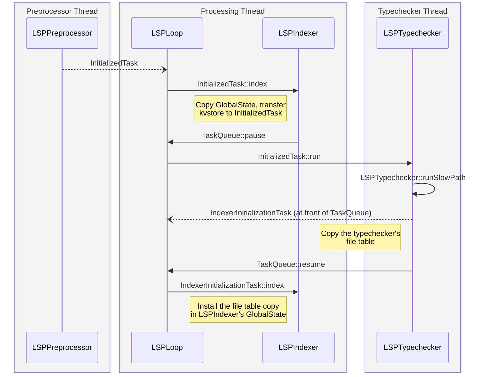
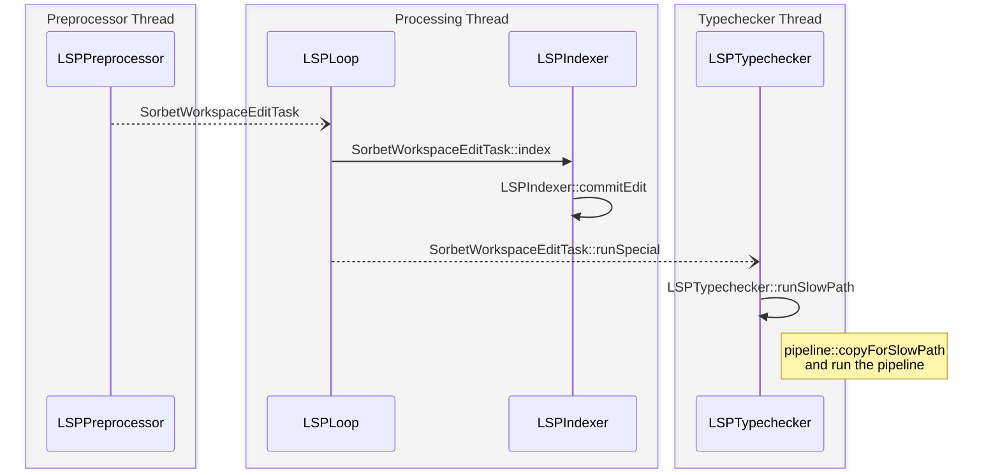

# LSP

## Threads

In multithreaded mode, Sorbet's language server runs these threads. Comments in
`main/lsp` refer to them by these names.

- **Reader** (`lspReader`): reads messages from the client into a message
  queue. Watchman has its own reader (`watchmanReader`) for file change events.
- **Preprocessor** (`lspPreprocess`): turns messages into `LSPTask`s, merges
  consecutive edits (`LSPPreprocessor::mergeFileChanges`), and pushes the tasks
  onto the `TaskQueue`.
- **Processing** (the thread that runs `LSPLoop::runLSP`): takes tasks off the
  `TaskQueue`, runs their `index` hook against the `LSPIndexer`, and hands them
  to the typechecker. It owns the `LSPIndexer`, except while it's waiting for a
  task that has its own way of handing the indexer to the typechecker thread
  (a preemption, or `SorbetWorkspaceEditTask::runSpecial`).
- **Typechecker** (`Typechecker`): runs tasks against the `LSPTypechecker`,
  including slow paths, and preemptions of slow paths.

## Initialization

Initialization begins when the `initialized` notification is sent by the client,
and received by the preprocessor thread. The preprocessor thread then
immediately queues a `InitializedTask` in the `TaskQueue` that the `LSPLoop`
consumes.

That task is dequeued in the `LSPLoop` instance running on the processing
thread, and run. When its `index` hook is called, it copies the indexer's
`GlobalState` and takes ownership of the `KeyValueStore` that is held by the
`LSPIndexer` in an instance variable, so that those values will be available
later when the `run` hook for that task is executed in the typechecker thread.
As initialization is not cancelable or preemptable, the task also pauses the
`TaskQueue` that the `LSPLoop` is reading from, to ensure that we don't attempt
to handle any queries without a valid `GlobalState` present.

Next the task's `run` hook is executed on the typechecker thread. This allows
the task to call the `LSPTypechecker::initialize` method, which kicks off a slow
path to populate the `GlobalState` copy from the indexer, using the
`KeyValueStore` if it's available. Once the slow path has finished, the
typechecker makes a copy of its file table to send back to the processing
thread.

> [!NOTE]
> Keeping the file tables of the indexer and typechecker threads in sync is
> necessary because the indexer uses both presence in the file table and the
> hashes for an entry to make decisions about which typechecking path to take:
> if either are missing the indexer has no way to take the fast path, and must
> default to the slow path.

The copy of the file table that's made in the `LSPTypechecker::initialize`
method is moved to an `IndexerInitializationTask`. The typechecker places the
task at the front of the queue, and unblocks the processing thread again. When
the processing thread wakes up and processes that event, the
`IndexerInitializationTask::index` hook will move the file table entries into
the `GlobalState` in the `LSPIndexer` instance.

## Slow Path

The slow path begins with the preprocessor thread translating edit events into a
`SorbetWorkspaceEdit` task. This task is then run on the processing thread, and
makes a fast or slow path decision when its `index` hook is run.

When it's determined that the slow path will run, the `LSPIndexer::commitEdit`
method will be called from either the `index` hook, or the `runSpecial` hook,
depending on how many files are modified. This method will bundle up all of the
changes necessary for running the slow path into a `LSPFileUpdates` value.

As the slow path will be run, the `SorbetWorkspaceEdit::runSpecial` hook will be
run on the typechecker thread to typecheck the change. At this point the
`LSPTypechecker` will create a copy of its `GlobalState` that contains the file
table, the name table, and a payload-initialized symbol table. The original
`GlobalState` will be stashed away on an `UndoState` object, as well as any
other state that would need to be reverted in the event of a cancelation. It
begins running the slow path (which is very similar to initialization) and then
if it hasn't been cancelled, it will commit the new `GlobalState` and free the
state held by `UndoState`.

## Fast Path, Preemption, and Cancellation

A `SorbetWorkspaceEditTask` is queued, then committed, then run (see the
comment on the class). Committing (`LSPIndexer::commitEdit`) applies the edit to
the indexer's file table, and decides whether it takes the fast path or the slow
path. An edit is only committed right before it runs, so the `TaskQueue` never
holds a committed edit, and the preprocessor and processing threads only merge
edits that haven't been committed.

When there's no slow path running, the processing thread commits the edit at the
front of the queue and runs it: synchronously on the typechecker thread if it
takes the fast path, or as a new slow path (`runSpecial`) if it doesn't.

While a slow path is running, the processing thread checks whether the task at
the front of the queue can **preempt** it. For an edit, that means taking the
fast path, which the indexer predicts without committing the edit
(`LSPIndexer::predictTypecheckingPath`). If it can, the processing thread
schedules a preemption (`LSPLoop::tryPreemptSlowPath`), and waits on the task
queue's mutex. The slow path checks for a scheduled preemption while it
typechecks each stratum. A task can only run once the slow path has reached the
stratum the task needs (`LSPTask::preemptionStratum`): for an edit, that's the
latest stratum of any file its predicted fast path typechecks. Until then, the
preemption is rescheduled for that stratum. When it does run, the typechecker
thread commits the edit while holding the task queue's mutex, and then runs it.

A slow path edit **cancels** the running slow path instead. Canceling restores
the typechecker's state from before the slow path (`UndoState`), so the
canceling edit's update has to include everything since then: the slow path's
own edits, and the fast path edits that preempted it. The indexer tracks those
in `LSPIndexer::pendingSlowPath`. If a slow path edit arrives behind
edits that are waiting to preempt, the processing thread moves the edits to the
front of the queue and merges them into one slow path edit
(`LSPLoop::promoteSlowPathEdits`), which cancels the slow path.
